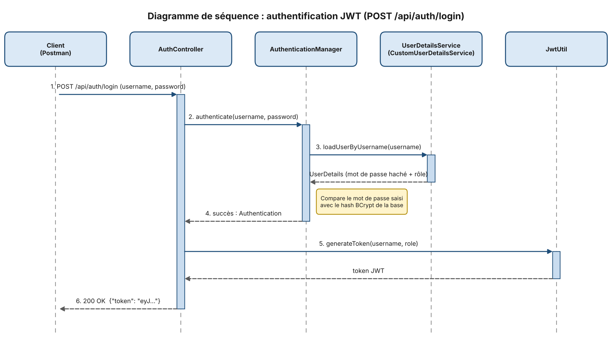
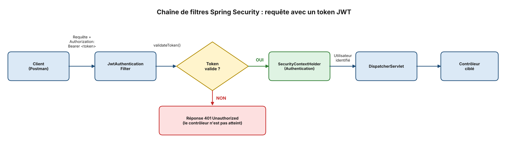

# Lab 4 – Sécurisation d'une API REST avec Spring Security et JWT

Projet réalisé dans le cadre du module **M10 – Développement Backend** (Master IAIDDWM).

Il ajoute une couche de sécurité au projet du Lab 3 (API REST Spring Boot / JPA / MySQL pour gérer des produits, des catégories et des commandes) : inscription, connexion, authentification **stateless** par **JWT** et contrôle d'accès **par rôles** (`USER`, `ADMIN`).

---

## 1. Technologies

| Outil | Version |
|---|---|
| Java (JDK) | 21 |
| Spring Boot | 3.2.0 |
| Spring Security | 6.2 |
| JJWT (JSON Web Token) | 0.11.5 |
| Spring Data JPA / Hibernate | 6.3 |
| Base de données | MySQL |
| Build | Maven |
| Lombok | oui |

## 2. Prérequis

- JDK 21 (ou supérieur) et Maven
- IntelliJ IDEA (ou un autre IDE)
- MySQL en cours d'exécution (par exemple via XAMPP, port `3306`)
- Postman pour tester l'API

## 3. Structure du projet

```
lab4/
├── pom.xml
├── README.md
├── postman/
│   └── Lab4-Auth.postman_collection.json
├── docs/
│   └── uml/
│       ├── 01-sequence-authentification-jwt.png
│       └── 02-chaine-filtres-jwt.png
└── src/main/
    ├── java/com/example/shop/
    │   ├── Lab4Application.java
    │   ├── config/          (PasswordConfig, SecurityConfig, ...)
    │   ├── controller/      (AuthController, ProductController, CategoryController, OrderController)
    │   ├── dto/             (RegisterRequest, LoginRequest, JwtResponse)
    │   ├── entity/          (User, Product, Category, Order, ...)
    │   ├── repository/      (UserRepository, ...)
    │   ├── security/        (JwtUtil, JwtAuthenticationFilter, CustomUserDetailsService)
    │   └── service/
    └── resources/
        ├── application.properties
        └── db/
            ├── create_db.sql
            └── create_users.sql
```

## 4. Base de données et configuration

1. Démarrer MySQL.
2. Créer la base avec le script `src/main/resources/db/create_db.sql` (base **`lab3_db`**, réutilisée depuis le Lab 3).
3. La table des utilisateurs est décrite dans `src/main/resources/db/create_users.sql`. Elle est aussi créée automatiquement au démarrage grâce à `spring.jpa.hibernate.ddl-auto=update`.
4. Vérifier les paramètres de connexion dans `src/main/resources/application.properties` :
   - URL : `jdbc:mysql://localhost:3306/lab3_db`
   - utilisateur : `root`
   - mot de passe : à adapter à votre installation (vide avec la configuration XAMPP par défaut)

Table `users` :

| Colonne | Type | Contraintes |
|---|---|---|
| `id` | BIGINT | clé primaire, auto-incrément |
| `username` | VARCHAR(50) | obligatoire, unique |
| `email` | VARCHAR(100) | obligatoire, unique |
| `password` | VARCHAR(255) | obligatoire (haché avec BCrypt) |
| `role` | VARCHAR(20) | obligatoire (`USER` ou `ADMIN`) |

## 5. Build et lancement

Depuis le dossier du projet (celui qui contient `pom.xml`) :

```bash
mvn clean install
mvn spring-boot:run
```

Ou, dans IntelliJ : ouvrir le projet, puis lancer la classe `Lab4Application`.

L'API est disponible sur **http://localhost:8080**.

## 6. Fonctionnement de la sécurité

1. **Inscription** : le mot de passe est haché avec **BCrypt** avant d'être enregistré. Il n'est jamais stocké en clair.
2. **Connexion** : `AuthenticationManager` vérifie le nom d'utilisateur et le mot de passe (via `CustomUserDetailsService`). En cas de succès, `JwtUtil` génère un token signé (HS256, valable 24 h) qui contient le nom d'utilisateur et le rôle.
3. **Requêtes suivantes** : le client envoie le token dans l'en-tête `Authorization: Bearer <token>`. `JwtAuthenticationFilter` valide le token, identifie l'utilisateur et le place dans le `SecurityContextHolder`.
4. **Autorisations** : les règles par URL sont définies dans `SecurityConfig`, et les annotations `@PreAuthorize` placées sur les contrôleurs affinent les droits.

L'API est **stateless** (aucune session côté serveur), c'est pourquoi la protection CSRF est désactivée.

La configuration **CORS** (dans `SecurityConfig`) autorise les origines `http://localhost:3000` et `http://127.0.0.1:5500`, les méthodes `GET`, `POST`, `PUT`, `DELETE` et `OPTIONS`, ainsi que les en-têtes `Authorization` et `Content-Type`.

### Endpoints d'authentification (publics)

**POST** `/api/auth/register`

```json
{
  "username": "alice",
  "email": "alice@example.com",
  "password": "Password123",
  "role": "USER"
}
```

Réponse : `User registered successfully`

**POST** `/api/auth/login`

```json
{
  "username": "alice",
  "password": "Password123"
}
```

Réponse (200) :

```json
{ "token": "eyJhbGciOiJIUzI1NiJ9..." }
```

### Droits d'accès

| URL | Accès |
|---|---|
| `/api/auth/**` (register, login) | Public |
| `/api/products/**` | `USER`, `ADMIN` |
| `/api/categories/**` | `ADMIN` uniquement |
| `/api/orders/**` | `USER`, `ADMIN` |
| Toute autre URL | Utilisateur authentifié |

### Codes de réponse

| Code | Signification |
|---|---|
| 200 / 201 | Requête réussie |
| 401 / 403 | Accès refusé : token absent, invalide ou expiré, ou rôle non autorisé pour cette ressource |

## 7. Tests avec Postman

La collection `postman/Lab4-Auth.postman_collection.json` contient les requêtes utilisées pour tester l'API.

### Comptes de test

| Compte | Mot de passe | Rôle |
|---|---|---|
| `alice` | `Password123` | `ADMIN` |
| `marie` | `Password456` | `USER` |

**Précision sur la façon dont les tests ont été faits :** `alice` a d'abord été inscrite avec le rôle `USER` via `/api/auth/register`. Pour tester les droits `ADMIN`, son rôle a ensuite été modifié **directement dans la base de données** (phpMyAdmin) :

```sql
UPDATE users SET role = 'ADMIN' WHERE username = 'alice';
```

Comme le rôle est écrit dans le token, il faut se **reconnecter** après ce changement pour obtenir un token `ADMIN`. Il est aussi possible de s'inscrire directement avec `"role": "ADMIN"`. `marie` a ensuite été inscrite avec le rôle `USER` pour tester les droits d'un simple utilisateur.

### Utilisation

1. Importer la collection dans Postman (**Import**), puis démarrer MySQL et l'application.
2. Inscrire `alice` et `marie` si les comptes n'existent pas, puis passer `alice` en `ADMIN` avec la requête SQL ci-dessus.
3. Se connecter avec chaque compte (requêtes de login) pour obtenir un token.
4. Renseigner les tokens dans les variables de la collection (clic sur la collection, onglet **Variables**, colonne **Current value**) :
   - `json_web_token_05n9` : token d'`alice` (rôle `ADMIN`) ;
   - `json_web_token_0fpj` : token de `marie` (rôle `USER`).
5. Lancer les requêtes protégées : elles utilisent ces variables dans l'onglet **Authorization** (type **Bearer Token**).

Les tokens ne sont volontairement **pas publiés** dans ce dépôt : ils expirent au bout de 24 h et ne doivent pas être partagés. Il suffit de refaire un login pour en obtenir de nouveaux.

### Requêtes de la collection

| Requête | Méthode et URL | Token | Objectif |
|---|---|---|---|
| `Test user registration` | POST `/api/auth/register` | aucun | inscrire `alice` (rôle `USER`) : `User registered successfully` |
| `Test api auth login user` | POST `/api/auth/login` | aucun | login d'`alice` : 200 + token |
| `Login admin` | POST `/api/auth/login` | aucun | login d'`alice` après son passage en `ADMIN` : 200 + token portant le rôle `ADMIN` |
| `Add user registration` | POST `/api/auth/register` | aucun | inscrire `marie` (rôle `USER`) |
| `Auth user` | POST `/api/auth/login` | aucun | login de `marie` : 200 + token `USER` |
| `Test role admin` | POST `/api/products` | ADMIN | création d'un produit : accès autorisé |
| `Methode GET role user ou admin` | GET `/api/categories` | ADMIN | lecture des catégories : accès autorisé |
| `Methode POST pour test user ou admin` | POST `/api/categories` | ADMIN | création d'une catégorie : accès autorisé |
| `Test avec token user` | POST `/api/orders` | USER | création d'une commande avec le rôle `USER` : accès autorisé |
| `Test droit user` | POST `/api/orders` | USER | second test des droits du rôle `USER` sur les commandes |
| `Methode delete - role Admin` | DELETE `/api/orders/1` | ADMIN | suppression d'une commande : accès autorisé |

Les identifiants utilisés dans les requêtes (`categoryId`, `productIds`, commande `1`) correspondent aux données de la base de test : à adapter si la base est différente.

## 8. Diagrammes UML

**Séquence d'authentification JWT (login)**



**Chaîne de filtres Spring Security**



## 9. Bonnes pratiques et limites

- Les mots de passe sont hachés avec BCrypt.
- Le secret de signature du JWT est écrit dans `JwtUtil` pour ce lab. **En production, il doit être externalisé** (`application.properties`, variable d'environnement ou coffre-fort de secrets) et ne jamais être publié.
- L'inscription permet de choisir le rôle `ADMIN`, pratique pour tester le lab. Dans un vrai projet, ce choix serait interdit.

### Pistes d'amélioration (non implémentées)

- **Rôle `MANAGER`** : lecture des commandes et création de produits, sans suppression.
- **Rafraîchissement du token** : endpoint `/api/auth/refresh` renvoyant un nouveau token avant expiration.
- **Révocation des tokens compromis** : liste noire en base, durée de vie courte des tokens ou rotation du secret de signature.

## 10. Réalisé par

Khaoula BAHLOUL – Master IAIDDWM, module M10 Développement Backend.
